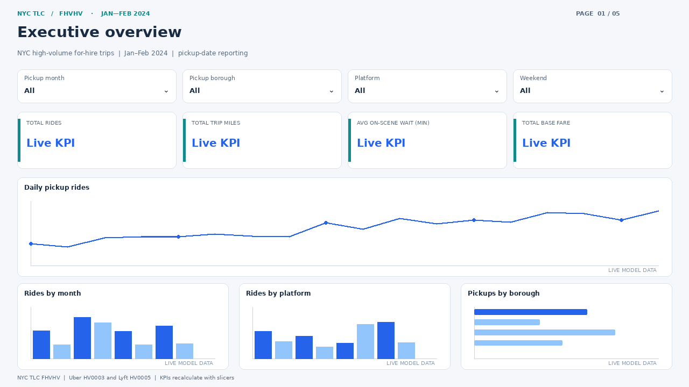
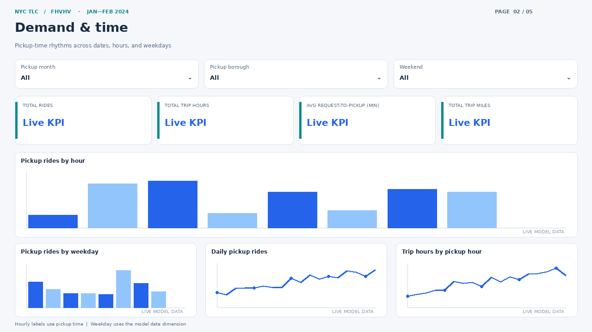
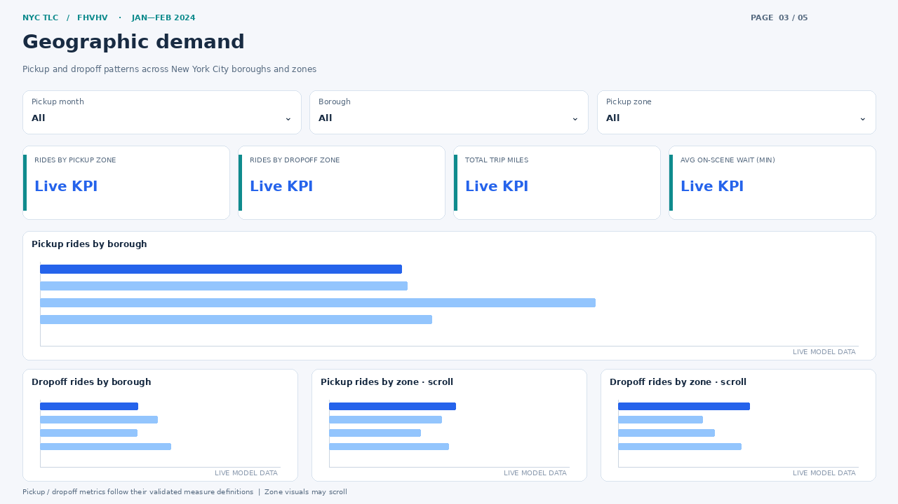
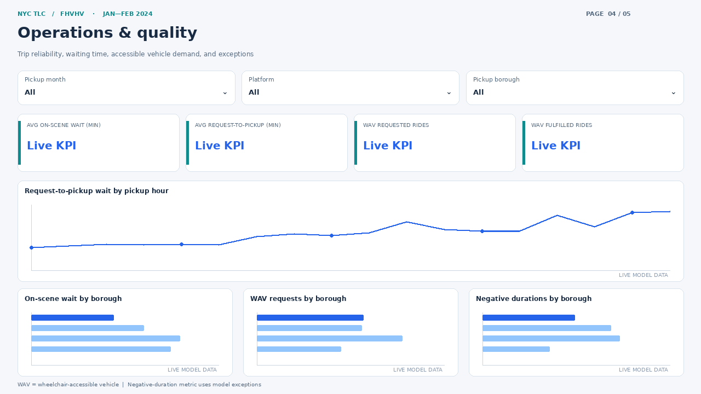
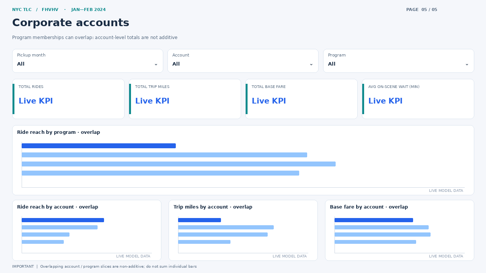
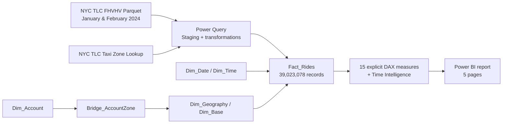

# NYC Ride-Share Intelligence

**39 Million Trips · NYC TLC FHVHV · Power BI · DAX · Power Query · Dimensional Modeling**

An end-to-end analytics engineering and executive reporting project built around **39,023,078 New York City high-volume for-hire vehicle trips** from **January–February 2024**. The project covers data preparation, semantic-model design, business measures, performance optimization, and a five-page interactive Power BI report.

[*⬇ Download the full Power BI Desktop report (.pbix) — Google Drive*](https://drive.google.com/file/d/1Y7_OIB0NW94KsAh9aA6Ox2pxD_lqMl1T/view?usp=sharing)

[Report source definitions](powerbi/) · [Engineering documentation](docs/) · [Official NYC TLC source data](https://www.nyc.gov/site/tlc/about/tlc-trip-record-data.page)

> **Image provenance:** The five images below are **schematic page-layout previews reconstructed from the Power BI report definition**. They illustrate the real page structure, but their chart shapes and the text `Live KPI` are placeholders—not exported dashboard data or verified screenshots. Actual query results are shown in the **verified benchmarks** section. Replace these previews with Power BI Desktop screenshots before claiming that the images display live results. The working Desktop report is available through the Google Drive link above.

## Dashboard — five pages

### 01 · Executive Overview

Executive KPIs, pickup trends, monthly demand, platform split, and borough analysis.

### 02 · Demand & Time

Ride patterns by pickup hour, day of week, and daily demand; time-of-day operational analysis.

### 03 · Geography

Pickup and drop-off demand by borough and TLC taxi zone, using separate role-playing relationship logic.

### 04 · Operations & Quality

Request-to-pickup and on-scene waiting times, WAV demand and fulfillment, and negative-duration exceptions.

### 05 · Corporate Accounts

Illustrative account and program reach using a many-to-many zone bridge. **Account and program totals can overlap; never sum them into a distinct portfolio-wide total.** Accounts are synthetic demonstration entities.

## Verified dataset and engineering results

| Metric | Verified value |
|:--|--:|
| All rides (Jan–Feb 2024) | **39,023,078** |
| January pickup rides | **19,663,930** |
| February pickup rides | **19,359,148** |
| Average on-scene wait | **3.07 minutes** |
| Average request-to-pickup | **4.16 minutes** |
| WAV requested / fulfilled | **Approximately 91K / 91K** |
| Semantic-model tables | **9** (including measure table and calculation group) |
| Explicit DAX measures | **15** |
| Report pages | **5** |
| Native Power BI visuals | **81** in supplied report definition |
| VertiPaq memory before → after pruning | **~1.99 GB → 782.51 MB** |
| Memory reduction | **Approximately 61%** |

*These values come from prior local model validation and performance diagnostics. They are not calculated from the images or this source-only repository.*

## Architecture

The report uses a dimensional model with active pickup-date, pickup-time, pickup-geography, and base relationships; inactive request/drop-off relationships are activated selectively in measures with `USERELATIONSHIP`. Corporate account analysis uses a zone bridge and a controlled bidirectional filter relationship.

See [the full model documentation](docs/semantic-model.md) and [measure catalog](docs/dax-measures.md).

## Engineering highlights

- **Power Query ETL:** Combined two monthly Parquet partitions, normalized keys, created date/time surrogate keys, calculated waiting durations, and pruned four high-cardinality raw datetime columns.
- **Semantic model:** Fact/dimension separation, hidden technical keys, explicit measures, role-playing relationships, and documented account-zone many-to-many behavior.
- **Time intelligence:** Calculation group with Current, MTD, YTD, and YoY % items; prior-year comparisons can be blank because only 2024 trips are loaded.
- **Performance:** The optimization reduced the in-memory model footprint by approximately 61%. A previously documented 6 ms query is a **specific benchmark**, not a guarantee for all visuals or hardware.
- **Data quality:** Negative durations, missing on-scene events, out-of-period request timestamps, and unknown borough labels are identified explicitly rather than silently altered.

## Download the full Power BI project

**[Get the full `.pbix` on Google Drive](https://drive.google.com/file/d/1Y7_OIB0NW94KsAh9aA6Ox2pxD_lqMl1T/view?usp=sharing)**

The complete file is **larger than 1 GB** and is deliberately hosted outside ordinary GitHub history. It is intended for opening in **Power BI Desktop on Windows**. Google Drive may show a preview or virus-scan warning for large files; use its Download function. The link's public permissions and the uploaded file's latest content must be checked by the owner.

**What this repository includes:** the cleaned five-page **Power BI report definitions** (`.Report`, PBIR JSON), layout-preview images, the measure catalog, and technical documentation.

**What this repository does not include:** the imported 39M-row cache, the full `.SemanticModel` folder, or a standalone working `.pbip`. This source archive was supplied as a **report-only** export. The report definitions reference a sibling `ubers latest september 2.SemanticModel` that is **not included here**. Do not attempt to open the report folder alone as a complete Power BI project. For a turnkey working copy, use the Google Drive PBIX. More detail: [reproduction and source limitations](docs/reproduction.md).

## Technical documentation

| Document | Contents |
|---|---|
| [Data pipeline](docs/data-pipeline.md) | Original datasets, ETL, model-ready keys |
| [Semantic model](docs/semantic-model.md) | Nine tables, active/inactive relationships, bridge behavior |
| [DAX measure catalog](docs/dax-measures.md) | All 15 intended measures and calculation-group logic |
| [Performance](docs/performance.md) | Model compression and query benchmark scope |
| [Data quality & interpretation](docs/data-quality.md) | Source anomalies and limitations |
| [Reproduction and files](docs/reproduction.md) | Full PBIX download, report-only source, refreshing prerequisites |

## Data provenance and limitations

Source: [NYC Taxi & Limousine Commission — TLC Trip Record Data](https://www.nyc.gov/site/tlc/about/tlc-trip-record-data.page), High Volume For-Hire Vehicle (FHVHV) records for January and February 2024, plus the TLC taxi-zone lookup.

This is an **independent portfolio project** and not an official NYC TLC dashboard. **Corporate accounts are synthetic**, account/program membership overlaps, and WAV matches reflect the source records rather than a general citywide service-quality conclusion. The published layout previews are not substitutes for in-app filtering, live report queries, or a reproducibility benchmark. No private customer data is necessary to understand the project.

---

**Author:** [Amir Khoshnafs](https://github.com/amirkhoshnafs) · [Portfolio](https://khoshnafs.netlify.app/)
